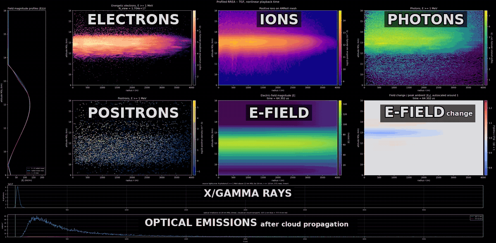

# RREA with WarpX and AMReX

The central idea of this project is to combine WarpX and AMReX with particle
transport data extracted from Geant4 in one self-consistent Relativistic
Runaway Electron Avalanche (RREA) model, including relativistic feedback from
X-rays, gamma rays, and positrons. WarpX owns the entire kinetic part of the
model: it transports electrons, positrons, and photons using the Geant4-derived
cross sections and final-state data for their interactions.
AMReX evolves the low-energy carrier fluid and electric field. The vendored
JAEA PARMA model adds realistic cosmic-ray secondary electron/positron seeding.

The goal is to reproduce the observed range of high-energy thunderstorm
phenomena, including terrestrial gamma-ray flashes (TGFs), flickering gamma-ray
flashes (FGFs), and gamma-ray glows, in a realistic altitude-dependent
atmosphere with self-consistent electric-field evolution and full relativistic
feedback from X-rays, gamma rays, and positrons.

<p align="center">
  
</p>
<p align="center"><em>E130: PARMA-seeded 200 us simulation through field quenching and peak activity (12.5 s excerpt; earlier 9–16 km domain and seed-rate model).</em></p>

This is primarily a scientific proof of concept rather than a production
software project. It tests whether these established components can be
combined into a physically credible end-to-end RREA model; it is not intended
to be a polished, portable, user-supported simulation package.

## Philosophy: vibe coding

This project is intentionally developed and operated through vibe coding. Code
changes, simulations, and repository maintenance are delegated to AI agents
instead of being performed manually. The model scope is fixed: agents operate
and improve the two production scenarios defined below and the RREA
Coleman--Dwyer multiplication test; they do not reshape the model around
arbitrary physics questions.
Results are evaluated after each run using governing equations, physical
consistency checks, and committed tests. The goal is never to edit a line of
code by hand.

## Production scenarios

`seed_source_model` in `config/rrea_defaults.json` selects one of two production
scenarios:

- `parma_continuous_column` (default): a continuous cosmic-ray secondary
  electron/positron column plus its stationary background at t = 0, derived
  from PARMA (`scripts/rrea_parma_source.py`). This is the realistic
  thunderstorm seeding environment and the default production mode.
- `parma_plus_1mev_pulse`: the same PARMA bath and continuous background plus
  one 1 MeV electron pulse in a narrow source region, representing an intense
  cosmic-ray shower. PARMA injection continues after the pulse and any quenching.
  `--macro-count` controls the pulse; the background count comes from
  `parma_continuous_source` in the defaults. This replaces the pulse-only mode
  for fresh runs; historical pulse-only captures are not migrated.

The separate `coleman_dwyer_7p2mev` mode is not a production scenario. It uses
the Coleman--Dwyer seed cohort to measure early spatial RREA multiplication;
photon/positron feedback and field coupling remain enabled.

## Production path and HPC targets

The repository keeps one schema-6 profiled-atmosphere production path. Its run
geometry, schedule, population policy and CPU-node layout are owned by
`config/rrea_defaults.json`; Git history holds superseded implementations.
`submit_profiled_video.sh` and the Coleman-Dwyer planner target Olivia (project
nn9526k) CPU nodes; `submit_gpu.sh` targets its GH200 nodes, whose retained
layout is the explicit command in `docs/OLIVIA_GPU.md`.

## Experimental CUDA backend

The experimental CUDA backend has field/fluid kernels, energetic
electron/positron/photon histories, secondary newborn transport and
population kernels; MPI routing, ordered deposition/ledger replay and
insertion stay on the host. See
[`docs/GPU_PORT.md`](docs/GPU_PORT.md) for kinetic scope, ownership, runtime
controls, building, acceptance and reproducible CPU checks.

## Project contract

The tracked kinetic
bundle lives in `rrea_transport_tables/schema6/production/` as RREATBL
containers; the low-energy table lives in `rrea_fluid_closure/`.
The C++ loaders enforce runtime semantics; focused tests and the fluid-source
scripts check the shipped physical data.
`scripts/rrea_table_pack.py --help` is the reference for reading, unpacking
and repacking the tables.

## Layout

```text
native_amrex_rrea/     native AMReX state plus the WarpX RREA overlay
rrea_transport_tables/ and rrea_fluid_closure/ kinetic and fluid input data
rrea_parma_upstream/   vendored PARMA cosmic-ray model code and data (JAEA)
upstream/             exact WarpX/AMReX/Geant4 gitlinks to the davsar89 forks
cases/rrea/            canonical production input
EFIELD_profile/        altitude-dependent field and density profiles
cluster/olivia/        Olivia Slurm launchers and C&D campaign planner
scripts/               production runner, analysis, validation, and rendering
tools/                 optional offline Geant4 charged-reference extractor
docs/                  live architecture, rerun, and HPC guides
```

Start with:

- [`AGENTS.md`](AGENTS.md) for repository policy.
- [`docs/RREA_RERUN_GUIDE.md`](docs/RREA_RERUN_GUIDE.md) for local runs,
  restarts, products, and the all-physics campaign.
- [`Architecture guide (PDF)`](docs/RREA_WARPX_AMREX_ARCHITECTURE_GUIDE.pdf)
  for architecture and physics ownership.
- [`PIC explainer (PDF)`](docs/rrea_pic_explainer.pdf) for a shorter narrative
  introduction to the hybrid kinetic/fluid model and diagnostics.
- [`docs/README.md`](docs/README.md) for the live documentation index and active
  caveats.
